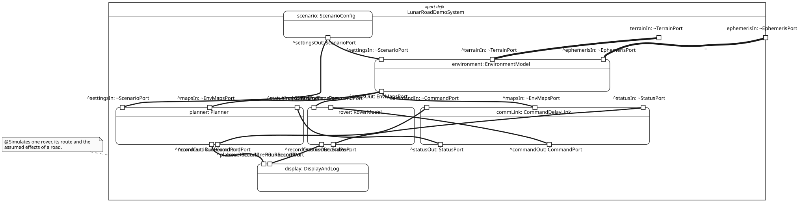
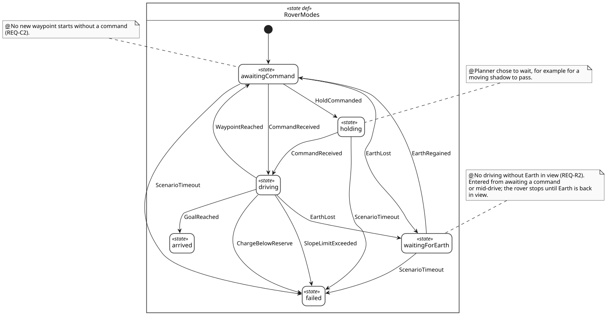
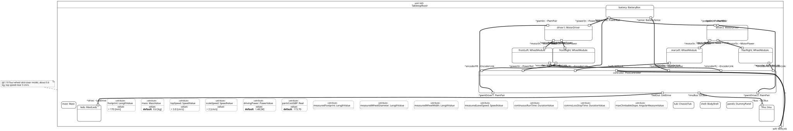
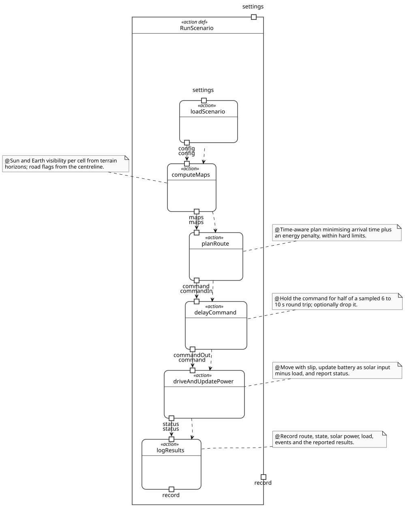

# Lunar Road Demo: SysML v2 model

A model-based systems engineering (MBSE) model of the Lunar Road Demo: a simulation that compares the same VIPER-class rover trip at the lunar south pole with and without a road, plus a 1:10 tabletop rover that replays the results.

The model is written in SysML v2 textual notation. It traces from mission need to requirements, to architecture, to verification. Every value comes from the project specs, which cite public NASA and supplier sources. VIPER details are a public-source reconstruction, not NASA's design.

**Validated:** all eight model files parse and validate with zero errors and zero warnings on the SysML v2 Pilot Implementation 0.63.1 (release 2026-09.1).

## Diagrams

Rendered from the model by the Pilot Implementation.

| Logical architecture (IF-03 to IF-07) | Rover operating modes |
|---|---|
|  |  |

| 1:10 rover electrical design (E1 to E5) | One simulation run |
|---|---|
|  |  |

More in [`diagrams/`](diagrams): system context, part tree, requirement diagrams and road preset variants.

## What's in the model

| File | Contents |
|---|---|
| `01_Structure.sysml` | Logical architecture: environment, planner, command delay link, rover (mobility and power), display, scenario config. Items, ports and interface definitions IF-01 to IF-07, all connected. |
| `02_Context_UseCases.sysml` | Actors (viewer, lunar terrain, ephemeris) and use cases. |
| `03_Requirements_Sim.sysml` | 24 simulation requirements: REQ-M, P, E, C and R keep the spec's IDs; the spec's other "shall" statements are REQ-MVP1 to MVP10, IDs assigned in this model. Numeric ones are written as checkable constraints. |
| `04_Behaviour.sysml` | Functional flow of one run, a road versus no-road comparison, and the rover operating mode state machine (awaiting command, driving, holding, waiting for Earth, arrived, failed). |
| `05_RoadPresets_Variants.sysml` | Variability: four road presets and three awake-load presets, with two example configurations from the 24-run stored set. |
| `06_Hardware_1to10.sysml` | Physical architecture of the 1:10 rover (Pico 2 W, DRV8833 drivers, four encoded gearmotors, IMU, LEDs, NiMH battery), connections E1 to E6 including encoder feedback and battery sensing, VIPER reference blocks, and allocations matching the spec's VIPER-to-tabletop table. |
| `07_Requirements_Hardware.sysml` | 10 build requirements (REQ-H1 to H10), plus the spec's scale-model caveat as REQ-H11. |
| `08_Verification_Traceability.sysml` | 16 verification cases with methods (test, analyse, inspect, demo), satisfy relations, and allocation of run steps to logical elements. |
| `traceability.csv` | Requirement to verification matrix, generated from the model. |
| `diagrams/` | Twelve diagrams rendered from the model (SVG). |
| `notebooks/LunarRoadDemo.ipynb` | Loads every file in order and renders the diagrams. |

## Key modelling decisions

- **Sourced versus assumed values.** Sourced values (447 kg mass, 15° slope limit, 5,420 Wh battery, 6 to 10 s round trip) are bound with `=`. Assumed values (250 W awake load, 20% reserve, every road preset value, packet drops) use `default`, so they stay configurable, as the spec requires (REQ-MVP4). Derived values are marked as derived.
- **The road changes only road flags.** Both runs share one rover, planner and environment. The road presets are variants, not structural changes (REQ-E3).
- **The physical rover reuses the simulation interfaces.** Its Wi-Fi link carries the IF-04 and IF-05 message fields, with battery voltage in place of state of charge, so the hardware places no new requirement on the simulation.
- **Allocation, not copying.** VIPER blocks are allocated to tabletop stand-ins (for example IAU and SEPIA to the Pico 2 W). That makes the gap between the model and VIPER explicit.

## Verification coverage

All 35 requirements are verified by at least one case. The hardware checks CK-H1 to CK-H8 follow the spec's own "Covers" column. The simulation spec's checks CK-1 to CK-5 do not say which requirements they cover, so every simulation mapping is this model's judgement, and each check verifies only what its pass condition actually tests. Three checks are **proposed additions**, marked PROPOSED in their names: **CK-6** (planner, power and delay unit tests), **CK-7** (results and delivery review) and **CK-H9** (scale-model caveat).

None of the hardware checks has been run yet, because the rover is not built.

## How to run it

1. Install Java 21+ and Miniconda.
2. Download the SysML v2 Jupyter kernel from the [SysML v2 Pilot Implementation releases](https://github.com/Systems-Modeling/SysML-v2-Pilot-Implementation/releases) and run its `install.sh` (or `install.bat`).
3. Run `jupyter lab`, open `notebooks/LunarRoadDemo.ipynb`, and run all cells.

You can also import the `.sysml` files into [SysON](https://mbse-syson.org) for graphical editing.

To regenerate the traceability matrix after editing: `python3 tools/trace.py model/`

To regenerate the diagrams with Java 21 and a recent Graphviz (2.43 fails on interconnection views): `java -cp jupyter-sysml-kernel-0.63.1-all.jar tools/RenderDiagrams.java <sysml.library> diagrams/`, with `GRAPHVIZ_DOT` pointing at `dot`.

## Next steps

- A power trade study as an `analysis def`, using results from the space-power-sims project.
- Link CK-3 and CK-4 to actual simulation outputs as verification evidence.
- A Mars variant (no long lunar night, dust storms, longer comms delay), using SysML v2 variation.

## Sources

The model is derived from three project documents: *Lunar Road Demo MVP: System Boundary and Simulation Conditions*, *VIPER Electrical Architecture Reconstruction*, and *Lunar Road Demo: 1:10 VIPER-Look Rover Hardware Design*. Their NASA and supplier sources are listed in those documents.
